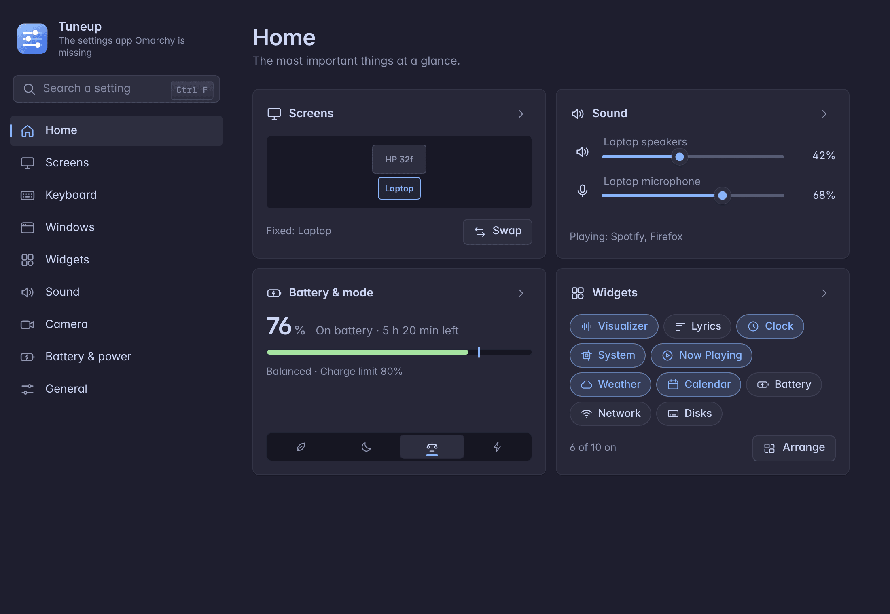
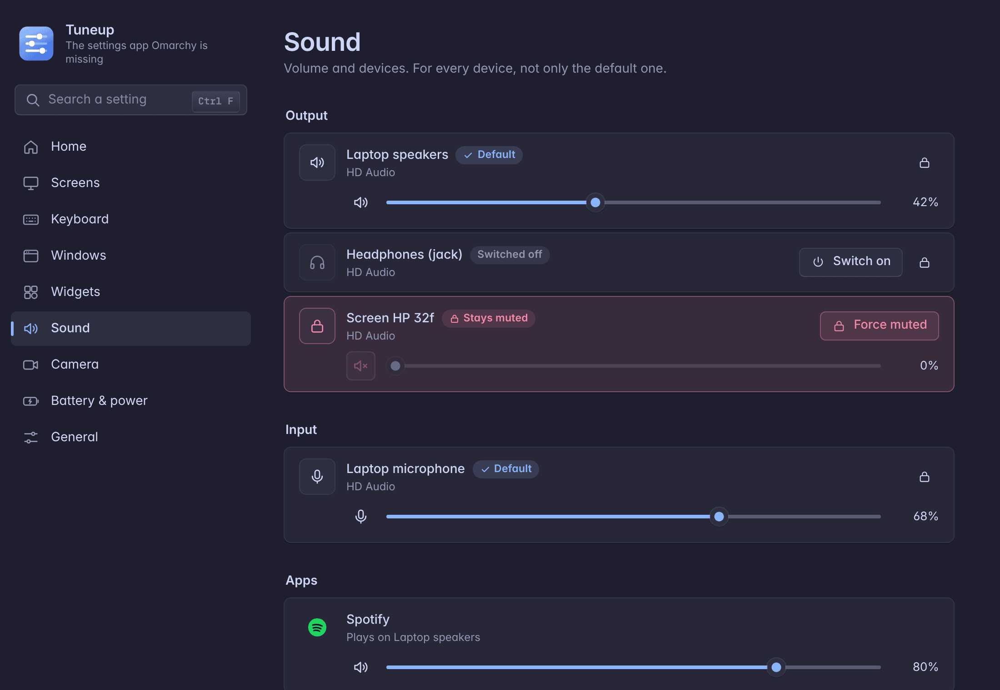
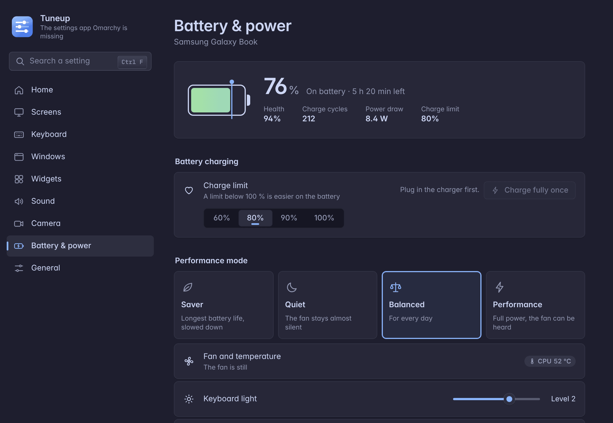
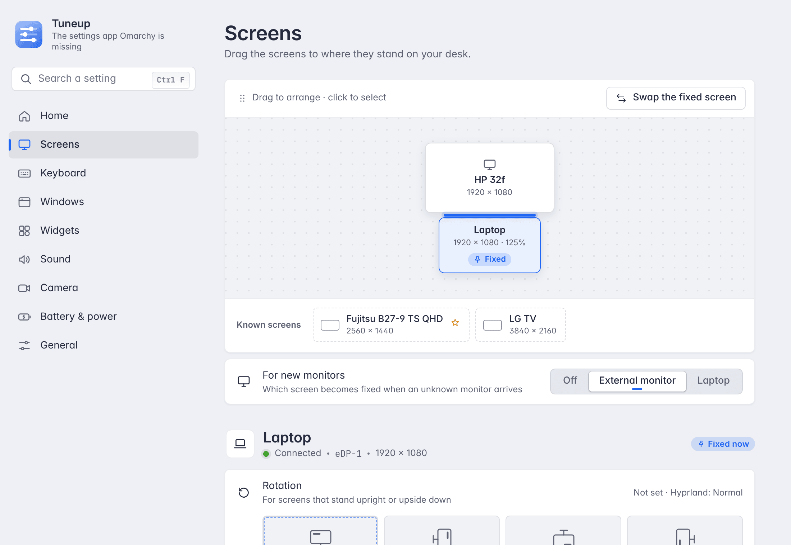

# Tuneup

**The settings app Omarchy is missing.**



| Feature | What you get |
|---|---|
| **Screens & desktops** | Every monitor is remembered with its own rotation, scaling, resolution and place. Drag screens into position. A setting can apply only while a certain monitor is connected. Optionally, one screen keeps one fixed desktop. |
| **Window look** | Gaps, corners, borders, blur, transparency and animation speed, with a live preview and presets. Some apps can get their own transparency. |
| **Desktop widgets** | Clock, lyrics, a music visualizer, now playing, weather, calendar, system, battery, network and disks. You arrange and color them right on the desktop and save layouts per desk. |
| **Sound** | Volume for every device and every app, the default device, and which output each app uses. Force Mute keeps a device silent for good. |
| **Camera** | Turns the camera picture for every app (Discord, Zoom, the browser), like a monitor. |
| **Minimize windows** | `SUPER + M` hides a window and `SUPER + I` brings it back. A window menu lets you **peek** at a hidden window without touching your layout. |
| **Keeps your settings in force** | When another app or a reload changes something you set, Tuneup puts it back. |
| **Galaxy Book support** | Samsung Settings on Linux: charge limit, the four performance modes, keyboard light and the firmware switches. Every other laptop works fully too. |

One window, opened from the tray. English, German, Spanish, French or Italian, with a search, and it works by mouse or keyboard.

> Unofficial – not part of Omarchy.

## Install

```bash
curl -fsSL https://raw.githubusercontent.com/SlowlyTz/tuneup/master/install.sh | bash
```

or

```bash
git clone https://github.com/SlowlyTz/tuneup.git && ./tuneup/install.sh
```

The installer checks your system and installs what is missing from the official Arch repositories only (nothing from the AUR). It asks for your password once and offers the optional parts (camera, visualizer, Galaxy Book). Then it opens Tuneup, which from then on lives in the tray. Details: [docs/install.md](docs/install.md).

**Update or uninstall:** in the app under **General → About**, or with `tuneup update` / `tuneup uninstall`.

## Use

| Key | Does |
|---|---|
| `SUPER + M` | minimize window |
| `SUPER + I` | bring it back |
| `SUPER + .` | window menu (`-` = peek) |
| tray icon | Tuneup settings |

All keys can be changed in the app under **Keyboard**.

## Screenshots

| Screens | Widgets |
|---|---|
|  |  |
| **Windows** | **Sound** |
|  |  |
| **Battery & power** (Galaxy Book) | **Light mode** |
|  |  |

## Docs

| Doc | What is in it |
|---|---|
| [install.md](docs/install.md) | install, update, uninstall, what goes where |
| [settings-window.md](docs/settings-window.md) | the app: pages, search, keys |
| [daily.md](docs/daily.md) | cheat sheet: the keys and commands you use every day |
| [screens.md](docs/screens.md) | rotation, scaling, resolution and place of each monitor, and settings tied to a monitor |
| [one-desktop.md](docs/one-desktop.md) | one fixed desktop on one screen, desktops 1–10 on the other |
| [personalization.md](docs/personalization.md) | window look and desktop widgets |
| [sound.md](docs/sound.md) | volume per device and app, Force Mute |
| [camera.md](docs/camera.md) | the turned camera for every app |
| [minimizer.md](docs/minimizer.md) | minimize, bring back and peek at windows |
| [keys.md](docs/keys.md) | change a shortcut |
| [keep-settings.md](docs/keep-settings.md) | how Tuneup keeps your settings in force |
| [samsung.md](docs/samsung.md) | Galaxy Book support: charge limit, performance modes, firmware switches |
| [troubleshooting.md](docs/troubleshooting.md) | when something does not work |

## Requirements

- [Omarchy](https://omarchy.org/) on Arch Linux with Hyprland ≥ 0.56 (Lua config)
- Python ≥ 3.10; the installer adds the rest from the Arch repositories (PyGObject, libadwaita, WebKitGTK 6.0, the Inter font, ffmpeg, brightnessctl, git)

## License

MIT — see [LICENSE](LICENSE).
