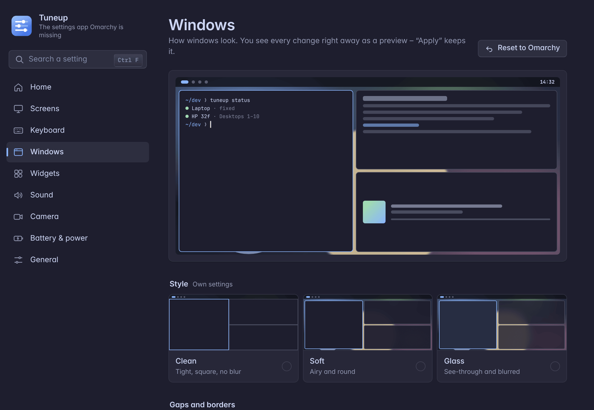
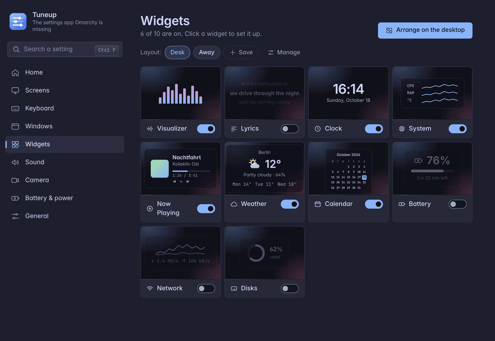

# Personalization

Two pages of Tuneup: **Windows** for the look of the windows, and **Widgets** for the desktop widgets.

## Windows

Gaps between windows and at the screen edge, corner rounding, border width, blur (on/off, strength, quality) and the transparency of the active and the other windows.

- **The look shows while you edit.** The preview on top and Hyprland itself show the new look as you move the sliders. **Apply** (in the bar at the bottom) keeps it, and a dialog asks **Keep?**. Without an answer the old look comes back after 15 seconds. **Discard** brings the old look back at once.
- **Presets** (Clean, Soft, Glass) fill in the sliders.
- **Border colors:** "Own border colors" draws the active window's border as a gradient of two colors (with transparency) at an angle. Off, the theme's border is back.
- **Animation speed:** Omarchy's animations (from its `looknfeel.lua`, and yours where you changed one) run 0.25× to 3× as fast.
- **See-through apps:** pick an open app and give its windows their own transparency, for the active window and the others. This is a window rule by window class.
- Taking app rules or the own border back takes a short reload of Hyprland; everything else changes live.
- **Reset to Omarchy** (top right) forgets your look, and the Omarchy theme decides again. Hyprland reloads its config for that.

The look is saved in `~/.config/tuneup/config.json` under `look`. It is written into Tuneup's generated Hyprland file, which loads after the Omarchy theme and so wins over it.

## Widgets

Widgets sit on the desktop **behind the windows**. The Widgets page shows each with a small preview and a switch, and the layouts as chips. Click a widget to open its page, with two tabs:
- **Content:** what it shows.
- **Where & when:** screens, desktops, visibility.

Colors, font, effect and background card are set **on the desktop**, while arranging.

| Widget | Shows | Settings |
|---|---|---|
| **Visualizer** | bars moving with the sound playing (cava) | in the bar, on the desktop or both; the app it listens to; bars, style (from the bottom, mirrored from the middle, wave, dots, circle), room between bars, sensitivity, smoothing, peak marks |
| **Lyrics** | the words of the song playing, in time with the music (from lrclib.net) | highlight (current line, word by word, off), lines (1–10), hide while paused |
| **Clock** | time and date | style (digital, analog, flip cards, in words – "quarter past six" in the app's language), 24 or 12 hours, seconds, weekday, date format (long, medium, short, ISO or an own pattern), a second time zone |
| **System** | CPU, memory and temperature with a curve of the last two minutes | each gauge on or off, curves on or off |
| **Now Playing** | the song playing: cover, title, artist, album, progress, time, and buttons (back, play/pause, next) that take clicks while the rest of the desktop stays clickable | the app it follows, cover beside or above the text, each part on or off, hide while nothing plays |
| **Weather** | the weather at the place set in Omarchy's weather panel (open-meteo): icon, temperature, place, feels like, humidity, wind, the next three days | Celsius or Fahrenheit, place, details, next days |
| **Calendar** | this month, today marked, the neighbouring months' days dimmed | week starts on Monday or Sunday, month name, week numbers |
| **Battery** | the charge as a ring (charging and low colors), percent, time left or until full | percent, time left, low at |
| **Network** | download and upload right now (all devices but loopback) with curves | curves |
| **Disks** | every disk once (btrfs subvolumes count as one; small boot partitions left out): used of its size, a bar | free space instead of used |

When a widget shows (**Where & when**): only on some desktops (1–10 or the fixed screen; none picked: on every one), only while its desktop has no window, not on battery, and **above the windows** instead of behind them.

Every widget can show on the laptop screen, all external screens, all screens, or one particular external monitor (recognised by its make, model and serial, whatever port it is on).

- **Placing:** a widget switched on for the first time appears in the middle of the screen and arranging starts. While arranging, every screen with a widget shows just the wallpaper – an empty desktop – with the widgets on it: drag them, pull the handles on their frame to resize them, turn them with the wheel (5° a notch, 1° with Shift), then **Save** or **Cancel** in the bar at the top of the screen (Enter saves, Esc cancels). **Arrange on the desktop** in the app (or **Arrange widgets** in the tray menu) starts it again later.
- **Style while arranging:** "Style" in the bar at the top switches from moving to styling. A click on a widget opens the style panel beside it – it never covers the widget or the bar, and it can be dragged by its title (it stays there while it does not hide the widget picked). Its folds (one open at a time) are **Colors**, **Font**, **Effect** and **Card**. Colors first colors the whole widget: its **base color**, which every part on "Widget accent" takes, from the theme's colors, the **wallpaper's** main colors, the own colors used last or an **own color** (saturation and brightness, hue, opacity, or typed as #rrggbb[aa]). **Color schemes** make all parts at once from the base: Theme (all defaults back), One color, Contrast, Pastel, Colorful, Muted. **Apply to all widgets** gives the others the same base and colors for the same kind of part (text, quieter parts). **Fine-tuning** opens the single parts (• marks the ones with an own color); then a click on a part of the widget – the clock's colon, a gauge's curve, the card – picks it directly. A color or scheme under the pointer shows on the widget at once; a click takes it. **Font** (widgets with text): the family from the installed fonts (searchable, each with a sample), the weight and the letter spacing; for the lyrics also the alignment, the size of the line being sung and the scroll time. **Effect**: none, outline, shadow or glow with its strength, and the widget's opacity. **Card**: on or off, its opacity, corners, room around and the blur behind it (the blur shows on the desktop once saved). **Ctrl+Z** or ↶ takes back the last color or look change, "Reset" gives the whole widget its defaults back, "Default" one part. Esc closes the panel, a second Esc cancels. Save keeps colors, looks and places together.
- **Resizing:** a corner scales the whole widget; an edge makes it only wider or taller (the visualizer's bars get thicker or longer, the system widget wider). The lyrics' box is their text: its height is shared by the visible lines and the font fills each line, a line too long for the width gets smaller or takes two rows. The clock always scales. The opposite side stays where it is, also on a turned widget. The size is set only here, not in the app.
- The place is a point on the screen as a fraction of its size, so it fits every chosen screen. With **Same place on every screen** off, each screen keeps its own place and size: arranging on a screen changes only that screen (a screen not arranged yet uses the widget's common place).
- **Layouts** (in the Widgets overview) keep all widgets as they are – settings, places, colors – under a name. Load one by hand, or let it load by itself: "Load with the screens connected now" ties it to exactly the connected screens, and the watcher loads it whenever those screens are connected again.
- **Lyrics:** the lines scroll – the next one slides up from below into the middle and grows, the last one moves on up and fades. At the start and end of a song the lines fill the box from the top or down to the bottom, so no slot stays empty. With "Current line" the line being sung is in the accent color. "Word by word" colors each word as it is sung: from the word times of the lyrics when lrclib has them (enhanced LRC), otherwise spread over the line by the length of the words – most songs only have times per line, so it is an estimate.
- The lyrics follow the player that is playing; while none plays, the one from before (or one with music rather than a video). **React to** picks one app instead (e.g. Spotify) for the lyrics and the visualizer; the visualizer then listens only to that app's sound (its PipeWire stream) and stays still while that app plays nothing here – it never listens to the microphone.
- With "Word by word" the word being sung fills up letter by letter. **Scroll time** sets how long a line takes to move on, **Size of the line being sung** how much bigger it is than the others.
- The visualizer fades out after two seconds of silence (cava sleeps then) and the desktop widgets hide while a window is fullscreen.
- The bar visualizer sits right after the desktops. cava is offered by the installer, or installed from the visualizer's page when it is missing (password).

Under the hood: the Omarchy shell plugin `hypr-screens.widgets` (`omarchy-widgets/`, a service plus a bar widget; the id keeps its old name) reads `~/.config/tuneup/widgets.json`, which the app writes. The app talks to it with `omarchy-shell hypr-screens.widgets edit | editing | placements | done | cancel`, and the overlay saves through `tuneup widgets save`.
