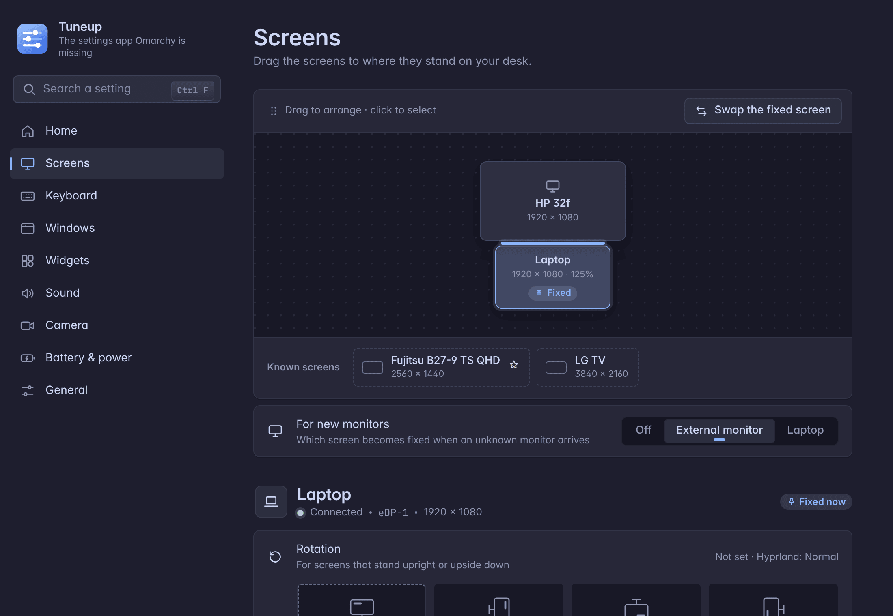

# The app

Tuneup opens from the **tray icon** (Omarchy: the `<` in the bar) or with `tuneup settings`. If it is already open on another desktop, or minimized, it comes to the desktop you are on. Closing the window ends it completely; the tray icon stays.



The app takes the colors of your Omarchy theme, light or dark. It speaks English, German, Spanish, French or Italian (**General → Language**; English where a text is missing). Every change is saved and applied at once, with **Undo** in the message at the bottom.

Two kinds of change ask again, because a wrong one can leave you without a usable screen: a screen's rotation, scaling, resolution or place, and the window look after **Apply**. Without an answer they go back by themselves after 15 seconds.

| Page | What is there |
|---|---|
| **Home** | the screens in small with **Swap**, volume, battery and performance mode, the widgets on and off |
| **Screens** | The screens as they stand on your desk: drag one to another edge of the laptop, and the mouse crosses there. Below, for the screen you clicked: rotation, scaling, resolution and refresh rate, and "Always shows the same desktop". Each setting can apply always or only while a certain other screen is connected (the chip **Always ▾**). A setting that is not set shows, dashed, what Hyprland does now. Screens known from before but not connected are in a row below the picture. Under **Advanced**: favorite, forget. See [screens.md](screens.md). |
| **Keyboard** | the keys that minimize and bring back windows, two per action (click one and press the new keys), and the desktop keys (`SUPER + 1…0`). See [keys.md](keys.md). |
| **Windows** | A live preview, presets, gaps, corners, border and transparency. Under **Advanced**: blur, animation speed, own border colors, see-through apps. Changes show in Hyprland while you edit; **Apply** keeps them, **Discard** brings the old look back. See [personalization.md](personalization.md). |
| **Widgets** | every widget with a small preview and a switch, the layouts as chips, and **Arrange on the desktop**. A widget's page has the tabs *Content* and *Where & when*. Colors, font, effect and card are set on the desktop while arranging. |
| **Sound** | volume per device and per app, the default device, Force Mute, the output of each app. See [sound.md](sound.md). |
| **Camera** | the turned virtual camera ("Rotated Camera") with a preview, and its one-time setup. See [camera.md](camera.md). |
| **Battery & power** | only on a Galaxy Book: charge limit, performance mode, keyboard light, device settings. See [samsung.md](samsung.md). |
| **General** | Language, and **Keep my settings** with the latest corrections (see [keep-settings.md](keep-settings.md)). The guide, the settings folder, and **About** (see below). |

Narrower than 900 pixels, the sidebar shrinks to its icons.

## Welcome and About

Tuneup shows a short **welcome** once after it was installed, and once after each update. After an update it shows the old → new version, with **What's new?**.

**General → About** has:
- the version,
- **Check for updates**, then **Update**,
- **Uninstall …**, with the checkbox **Keep the settings** (on by default),
- links to Tuneup on GitHub and to all releases with their changes.

Updating and uninstalling are explained in [install.md](install.md).

## Search

Use the field at the top of the sidebar, or press `Ctrl+F`. It finds pages and single settings by their names and by other words for them: "volume" finds Sound, "monitor" finds Screens. Pick a result and the page opens and scrolls to the setting, unfolding **Advanced** if it is in there. The setting stays marked for a moment.

## Keys

| Key | Does |
|---|---|
| `Ctrl+F` | search |
| `↑` / `↓`, `Enter` | choose and open a result |
| `←` / `→` | move within a row of buttons (rotation, scaling, …) |
| `Esc` | close a menu or dialog, empty the search |
| `Ctrl+Q`, `Ctrl+W` | close the window |

## For developers

The app is a web page (`hypr_screens/web/`) in a WebKitGTK window. It also runs in a plain browser: without the app around it, `mock.js` fills it with made-up screens, devices and widgets, so you can work on it without touching your system. It is made of ES modules, which browsers only load over http (not from `file://`). Serve the package folder; the mock reads the translations from `../locales.json`:

```bash
python -m http.server 8765 -d hypr_screens
# then open http://127.0.0.1:8765/web/index.html?lang=de
```

`?lang=de` picks the language, `?mode=light` the light colors. Everything the page can ask the app is in [`hypr_screens/web/API.md`](../hypr_screens/web/API.md).

`index.html` loads `bridge.js` (the link to Python, and the theme's colors), then `mock.js` when there is no app, then the module `app.js`:

| Folder | What is in it |
|---|---|
| `core/` | the state and its loaders, the API, the texts (`t()`), numbers and errors, the pages and the route, the render and its handlers, one change with Undo |
| `ui/` | icons, the building blocks of a page (row, block, section), the controls, the popover with its list, the dialog, the toast |
| `pages/` | One module per page. Screens, Keyboard, Windows and Widgets each have a folder: the arrangement, the key recording, the look's preview, the schema-driven settings, layouts, previews. |
| `shell/` | the navigation and the render of the page, the delegated events, the search, the live updates |
| `css/` | tokens, base, components, pages, and the narrow window last |

Every page is a function that returns HTML. Its controls register their handlers under a stable key, and after each change the page is rendered again with the focus kept. Translations live in `hypr_screens/locales.json`, keyed by the English text.

Run the tests with:

```bash
python3 -m venv .venv && .venv/bin/pip install -e ".[dev]" && .venv/bin/python -m pytest
```

They fake `hyprctl`, so nothing touches a running Hyprland. After editing QML, run `omarchy-restart-shell`.
